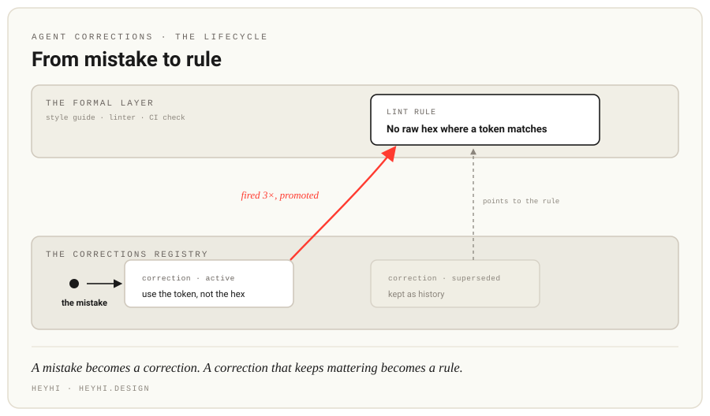

# agent-corrections

If your agent has made the same mistake three times, this is for you. That's
the ceiling most teams running agents in production hit eventually: the same
correction, re-explained in a new session, forever.

**Observability tells you what happened. This tells the agent what it
learned.** Trace and eval platforms (LangSmith, Arize, Langfuse, and similar)
answer "what did the agent do, and was it right." `agent-corrections` answers
a different question: "what has this agent already been told not to do, and
is it loaded before it does it again." The two are complementary, not
competing. See [`DESIGN_RATIONALE.md`](DESIGN_RATIONALE.md) for the fuller
distinction.

In practice: structured correction capture, loaded at the start of every
session, with a human-curated lifecycle that promotes patterns proven over
time into permanent rules.


## The schema, in three lines

The three fields a human needs to understand the pattern -- a schema-valid
entry needs six (`category`, `severity`, and `status` complete it):

```yaml
- id: hardcoded-hex-bypasses-token
  trigger_context: Generated component code in a project with a design token system.
  correction: A color literal that matches an existing token's value should reference the token, not the hex.
```

The full schema (seventeen fields, six required, all documented) is in
[`schema/corrections-schema.yaml`](schema/corrections-schema.yaml). The CLI reads
entries from the `entries:` key; a registry whose entries sit under any other key
fails loud and names it, and `migrate-key` renames that key in place.

## The lifecycle



```
mistake happens
    -> written as a correction entry (trigger_context + correction)
    -> loaded into every future session's context
    -> fires again, or doesn't (times_fired / last_fired track which)
    -> proves itself over enough fires
    -> promoted into a permanent rule elsewhere (a style guide, a linter, a
       hard-coded check) -- status flips to superseded, superseded_by records
       where the rule now lives
```

Full detail, including the promotion thresholds and the two review tiers, in
[`LIFECYCLE_SPEC.md`](LIFECYCLE_SPEC.md).

## Quickstart (under five minutes)

Requires Python 3.9+ (check with `python3 --version`). If `python3 -m pip
install` refuses with an "externally managed environment" error, create a
virtual environment first: `python3 -m venv .venv && source .venv/bin/activate`
(on Windows: `py -m venv .venv` then `.venv\Scripts\activate`).

```
git clone https://github.com/heyhi-design/agent-corrections.git
cd agent-corrections
python3 -m pip install -r requirements.txt

# Search the example registry
python3 src/corrections_cli.py search "token" --registry examples/example-registry.yaml
# -> one match: [hardcoded-hex-bypasses-token] (architectural, score 3.0), plus its correction text.

# See what a loaded session preamble looks like. Pick the format your runtime wants:
# claude (markdown), openai (imperative system message), or generic (plain text, any provider).
python3 src/corrections_cli.py inject --format generic --registry examples/example-registry.yaml
# -> a "CORRECTIONS (apply before doing the described work):" block, one bullet per active entry (ten, in this registry).

# Check the example registry for review-due entries and promotion candidates
python3 src/corrections_cli.py audit --registry examples/example-registry.yaml --as-of 2026-07-10
# -> "Schema: 12/12 entries valid.", then 1 promotion candidate (quoting its own
#    "Promotion clause:" line), 4 review-due entries, 2 never fired.
```

`--as-of` pins the reference date so this demo's counts don't drift as time
passes; drop it to check staleness against today instead. A review-due entry
is a prompt to look at it again, not a signal to delete it -- plenty of
corrections are durable environment facts that are correct precisely because
nothing has re-triggered them lately. Every command
above defaults to `corrections-registry.yaml` if you omit `--registry` --
these pass it explicitly only because they're pointed at the example file
instead of a real one.

Add your first correction to your own registry. Your registry lives in
*your* project, not this clone: `--registry` resolves against your current
working directory, so running this from your own project's root writes
`corrections-registry.yaml` there. Point the CLI at wherever you cloned this
repo -- an anchored path means the command works from any directory (the same
pattern `INTEGRATION_GUIDE.md` uses):

```
python3 /path/to/agent-corrections/src/corrections_cli.py add \
  --registry corrections-registry.yaml \
  --id my-first-correction \
  --category formatting \
  --severity factual \
  --trigger-context "when X is about to happen" \
  --correction "do Y instead"
# -> Added 'my-first-correction' to corrections-registry.yaml.
```

Then load it at the start of a session: see
[`INTEGRATION_GUIDE.md`](INTEGRATION_GUIDE.md) for provider-specific patterns
(Claude, OpenAI, and a provider-agnostic fallback).

## What this is

- A YAML schema for a correction entry, a CLI to search, add, audit and
  inject against it and to keep it honest over time (record fires, retire,
  recount, split an archive off, compare two registries), and a lifecycle
  spec for what happens after an entry proves itself.
- Provider-agnostic. The schema and CLI don't care which model or agent
  runtime is reading the injected context.
- Designed to be read by a human before anything gets promoted. Behavioral
  corrections (judgment calls about how the agent should work, not facts)
  require an explicit approval step; see `LIFECYCLE_SPEC.md`.

## What this isn't

- Not a hosted service. It's a schema, a local CLI, and a file you own.
- Not an observability or tracing platform. It doesn't watch your agent run;
  it stores what you've already learned from watching it.
- Not a replacement for the judgment behind a behavioral correction. The tool
  captures and loads corrections; deciding which ones are worth promoting to
  a permanent rule stays a human call.

## The commands

| Command | What it does |
|---|---|
| `corrections search "<query>"` | Find entries matching a keyword or phrase |
| `corrections add --category ... --severity ...` | Create an entry (auto-write for factual, approval-gated for behavioral) |
| `corrections audit` | Validate the registry's schema; report review-due entries and promotion candidates (`--recount` checks the meta counts, `--recount --write` fixes them) |
| `corrections inject --format claude\|openai\|generic` | Emit a session-preamble context block of active entries (`--max N` caps it, behavioral first) |
| `corrections fire <id>` | Record a recurrence on the entry itself: `times_fired` +1, `last_fired` stamped |
| `corrections retire <id> --reason ...` | Close an entry's validity window (retired, or superseded with `--superseded-by`); never deletes |
| `corrections migrate-key --from <key>` | Rename a registry's list key to `entries:`, changing only that line |
| `corrections split --archive <file>` | Move retired and superseded entries into an archive file, verbatim (`--verify` checks the pair) |
| `corrections compare <a> <b>` | Report likely duplicate lessons across two registries by trigger overlap |

Every command that writes is one of the named write verbs (`add`, `fire`,
`retire`, `migrate-key`, `split`) or takes an explicit `--write`. `fire`,
`retire`, `migrate-key`, `split` and `audit --recount --write` change only the
lines they must and refuse, writing nothing, when a file's layout makes that
unsafe. `add` splices the new entry in without touching existing text; only on
an unusual layout that carries no comments does it fall back to rewriting the
file.

`corrections` above is shorthand for `python3 src/corrections_cli.py` --
there's no installed console-script entry point yet, so every runnable
example elsewhere in this repo spells out the full invocation.

Each command's full flag list is in its own `--help`.

## Using it with a design system

If generated component code keeps drifting from your design tokens (a
hardcoded hex where a semantic token should be, a spacing value that doesn't
trace back to your scale), that drift is a correction like any other. The
example registry includes one: `hardcoded-hex-bypasses-token`. Capture it
once, load it every session, and the drift stops compounding.

## Related

[`keel`](https://github.com/heyhi-design/keel) is a
complementary open scaffold for skill-based agent context (structured,
task-scoped instruction files rather than one growing system prompt).
Correction capture pairs naturally with that layer, and the two repos ship
together.

## Contributing

Issues and PRs are welcome. See [`CONTRIBUTING.md`](CONTRIBUTING.md) for the
schema-change policy and the DCO sign-off requirement.

## Support

See [`SUPPORT.md`](SUPPORT.md).

## License

MIT. See [`LICENSE`](LICENSE). The MIT terms cover the code and documentation
in this repository; they don't extend to the "HeyHi" name, wordmark, or logo,
which are trademarks of Bay Design LLC and aren't licensed under those terms.

## Working with HeyHi

If your team is running corrections in production and finding patterns this
project doesn't cover, or if generated output keeps drifting from your design
system in ways worth talking through, HeyHi works on the infrastructure
behind agent workflows. No pitch, just a conversation: let's talk about what
fits. hello@heyhi.design / heyhi.design
